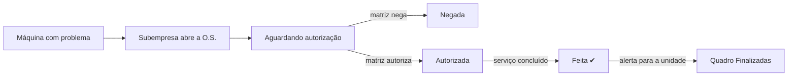

<p align="center">
  
</p>

<h1 align="center">RadarMind</h1>

<p align="center">
  <strong>Gestão inteligente e integrada para um futuro mais eficiente.</strong><br>
  Plataforma web para a matriz e as subempresas do agronegócio controlarem estoque, maquinário,<br>
  ordens de serviço, pedidos de reposição e alertas em um só lugar.
</p>

<p align="center">
  
  
  
  
  
  
  
</p>

<p align="center">
  <a href="https://radarmindgestaointeligente.infinityfreeapp.com/" target="_blank">
    <strong>🌐 Acessar a demonstração online</strong>
  </a>
</p>

---

## 📑 Sumário

- [Sobre o projeto](#-sobre-o-projeto)
- [Funcionalidades](#-funcionalidades)
- [Perfis de acesso](#-perfis-de-acesso)
- [Fluxos principais](#-fluxos-principais)
- [Tecnologias](#-tecnologias)
- [Do protótipo em Python ao Laravel](#-do-protótipo-em-python-ao-laravel)
- [Como rodar localmente](#-como-rodar-localmente)
- [Contas de demonstração](#-contas-de-demonstração)
- [Testes](#-testes)
- [Estrutura do projeto](#-estrutura-do-projeto)
- [Publicação em produção](#-publicação-em-produção)
- [Segurança](#-segurança)
- [Equipe](#-equipe)

---

## 💡 Sobre o projeto

Empresas do agronegócio com várias unidades costumam controlar peças, máquinas e manutenções em planilhas separadas. Por isso a matriz demora a saber o que falta em cada filial, e as filiais não sabem em que pé está cada pedido.

O **RadarMind** junta tudo em uma única plataforma:

- **A matriz** vê todas as unidades, aprova pedidos, autoriza ordens de serviço e gera relatórios consolidados.
- **Cada subempresa** cuida do próprio estoque, registra movimentações, abre O.S. e solicita reposições.
- **Os alertas automáticos** avisam as duas pontas na hora: estoque crítico, pedido pendente, máquina parada, O.S. finalizada.

## ✨ Funcionalidades

| Módulo | O que faz |
|---|---|
| 📊 **Dashboards** | Painel da matriz com o ranking de desempenho das unidades e painel próprio de cada subempresa com os indicadores da unidade. |
| 📦 **Estoque** | Cadastro de **peças avulsas** e **maquinário** com SKU, localização, lote, número de série, status (Ativo, Em manutenção, Inativo) e giro. Campos obrigatórios sinalizados e validados. |
| 🔄 **Movimentações** | Entradas e saídas com responsável e histórico. O estoque é atualizado automaticamente. |
| 🛒 **Pedidos de reposição** | A subempresa solicita, a matriz é avisada e a própria subempresa confirma a chegada. O estoque é somado automaticamente, uma única vez (Em aberto → Atendido / Cancelado). Os pedidos em aberto têm **filtro por unidade** feito em Vue 3. |
| 🛠️ **Ordens de serviço** | A subempresa abre a O.S. e a matriz autoriza, nega ou marca como **Feita**. As concluídas vão para o quadro **Finalizadas**. |
| 🔔 **Central de alertas** | Alertas por gravidade (**Crítico**, **Alerta**, **Concluído**) e categoria (Estoque, Pedidos, Maquinário, Manutenção), cada um com o botão da próxima ação. |
| 💬 **Notificações em tempo real** | Aviso no canto da tela sempre que chega um alerta novo, com link direto para a central. |
| 📄 **Relatórios** | Estoque, movimentações e desempenho, com pré-visualização, **impressão em PDF** e **exportação CSV** pronta para o Excel. |
| 🏆 **Medidor de desempenho** | Pontuação de 0 a 100 por unidade: 50% pelo volume de movimentações e 50% pelos itens de alto giro. |

## 👥 Perfis de acesso

<table>
  <tr>
    <th width="50%">🏢 Matriz</th>
    <th width="50%">🏭 Subempresas</th>
  </tr>
  <tr>
    <td valign="top">
      <ul>
        <li>Visualiza todas as unidades</li>
        <li>Relatórios consolidados ou por unidade</li>
        <li>Acompanha os pedidos de reposição de toda a rede</li>
        <li>Autoriza, nega e finaliza O.S.</li>
        <li>Recebe os alertas de toda a rede</li>
      </ul>
    </td>
    <td valign="top">
      <ul>
        <li>Gerencia apenas a própria unidade</li>
        <li>Controle de estoque e movimentações</li>
        <li>Solicita reposição e confirma a chegada</li>
        <li>Abre e acompanha O.S.</li>
        <li>Recebe os alertas da sua unidade</li>
      </ul>
    </td>
  </tr>
</table>

O acesso é protegido por perfil: uma subempresa nunca enxerga nem altera os dados de outra unidade.

## 🔁 Fluxos principais

### Pedido de reposição


### Ordem de serviço



## 🧰 Tecnologias

- **Back-end:** PHP 8.4, Laravel 13 (Eloquent, Observers, Form Requests, API Resources, Middleware)
- **Banco de dados:** MySQL / MySQL Workbench
- **Front-end:** Blade, CSS próprio e JavaScript puro, com **Vue 3** no filtro por unidade dos pedidos de reposição (via CDN, sem build obrigatório)
- **Padrão de código:** Laravel Pint
- **Prototipagem:** Python 3 + Flask, na primeira versão da API do módulo da subempresa

## 🐍 Do protótipo em Python ao Laravel

O módulo da subempresa começou como uma **API REST em Python com Flask**. Com ela, a equipe validou as regras de negócio e o formato do JSON antes de levar tudo para o sistema principal:
- isolamento dos dados por subempresa;
- validação de quantidades e bloqueio de saída sem saldo;
- itens em alerta (crítico quando o estoque fica na metade do mínimo ou abaixo);
- O.S. só para maquinário.

Depois que o contrato da API ficou estável, ela foi migrada para o Laravel. Os mesmos recursos agora usam o banco MySQL, o login e o controle de acesso do sistema. Por isso o painel da subempresa conversa com o back-end PHP pelos mesmos endpoints que usava no protótipo:

| Recurso | Protótipo (Python / Flask) | Versão atual (PHP / Laravel) |
|---|---|---|
| Dashboard e indicadores | `GET /api/dashboard` | `GET /subempresa/api/dashboard` |
| Estoque | `GET /api/estoque` | `GET /subempresa/api/estoque` |
| Movimentações | `GET /api/movimentacoes` | `GET /subempresa/api/movimentacoes` |
| Ordens de serviço | `GET /api/os` | `GET /subempresa/api/os` |
| Pedidos de reposição | `GET /api/reposicoes` | `GET /subempresa/api/reposicoes` |

> O protótipo guardava os dados em memória e simulava a subempresa logada. Na versão Laravel, esses dados vêm do banco e a unidade vem do usuário autenticado.

O código do protótipo está em [`prototipos/api-subempresa-flask`](prototipos/api-subempresa-flask), com as instruções para rodá-lo.

## 🚀 Como rodar localmente

### Pré-requisitos

- PHP **8.3 ou superior** com as extensões `pdo_mysql`, `mbstring`, `openssl` e `fileinfo`
- [Composer](https://getcomposer.org/)
- MySQL 8 (ou MariaDB)
- Opcional: [Laravel Herd](https://herd.laravel.com/) ou XAMPP para servir o projeto

### Passo a passo

**1. Clone o repositório**

```bash
git clone https://github.com/L-pf0/radarmind.git
cd radarmind
```

**2. Instale as dependências**

```bash
composer install
```

**3. Crie o arquivo de ambiente e gere a chave da aplicação**

```bash
cp .env.example .env
php artisan key:generate
```

> No Windows (PowerShell), use `copy .env.example .env`.

**4. Crie as tabelas e os dados iniciais**

```bash
php artisan migrate --seed
```

**5. Inicie o servidor**

```bash
php artisan serve
```

Acesse **http://localhost:8000**. No Laravel Herd, o projeto já fica disponível em `http://radarmind.test`.

## 🔑 Contas de demonstração

A seed cria a matriz, quatro subempresas e um estoque realista para cada uma (**353 itens** no total, entre peças e maquinário, além dos alertas iniciais).

| Perfil | E-mail | Unidade | Perfil do estoque |
|---|---|---|---|
| Matriz | `matriz@gmail.com` | MAT | Peças e frota completas |
| Subempresa | `subempresa01@gmail.com` | SUB01 | Operação geral |
| Subempresa | `subempresa02@gmail.com` | SUB02 | Pulverização |
| Subempresa | `subempresa03@gmail.com` | SUB03 | Solo e plantio |
| Subempresa | `subempresa04@gmail.com` | SUB04 | Colheita |

As senhas **não ficam no código**. Elas vêm das variáveis `SEED_SENHA_*` do seu `.env`.

## 🧪 Testes

O projeto tem uma suíte de testes automatizados com Pest. Ela cobre login e limite de tentativas, permissões por perfil, estoque, O.S., pedidos, alertas, notificações, relatórios (tela e CSV) e as seeds.

```bash
php artisan test
```

Para rodar só um arquivo:

```bash
php artisan test tests/Feature/RelatoriosTest.php
```

## 🗂️ Estrutura do projeto

```text
app/
├── Http/
│   ├── Controllers/        # Login, dashboards, alertas, O.S., pedidos e módulo RadarMind
│   ├── Middleware/         # GarantirPerfil: controle de acesso matriz / subempresa
│   ├── Requests/           # Validação de formulários (relatórios, pedidos)
│   └── Resources/          # Respostas JSON das telas dinâmicas
├── Models/                 # Itens, unidades, movimentações, O.S., pedidos e alertas
├── Observers/              # Geram alertas automaticamente quando algo muda
└── Support/
    ├── GeradorDeAlertas.php
    ├── MedidorDeDesempenho.php
    └── Relatorios/         # Montagem dos relatórios e exportação CSV
config/radarmind.php        # Layout e contas criadas pela seed
database/
├── migrations/
└── seeders/                # Unidades, usuários e estoque de demonstração
prototipos/
└── api-subempresa-flask/   # Protótipo da API da subempresa em Python + Flask
public/                     # CSS, JavaScript e imagens
resources/views/            # Telas em Blade
routes/web.php              # Rotas da aplicação
tests/                      # Testes automatizados (Pest)
```

## 🌍 Publicação em produção

O projeto roda em hospedagens PHP comuns, inclusive gratuitas. Resumo:

1. Rode `composer install --no-dev --optimize-autoloader`.
2. Crie o `.env` de produção a partir do [`.env.production.example`](.env.production.example), com `APP_ENV=production`, `APP_DEBUG=false` e uma `APP_KEY` nova.
3. Aponte o domínio para a pasta `public/`. Se a hospedagem não permitir, use um `.htaccess` na raiz que encaminhe tudo para `public/`.
4. Crie as tabelas com `php artisan migrate --seed` ou importe um dump SQL pelo phpMyAdmin.
5. Depois de ativar o SSL, use `APP_URL=https://...` e `SESSION_SECURE_COOKIE=true`.

## 🔒 Segurança

- Senhas guardadas com hash (bcrypt). As contas de demonstração leem a senha do `.env`, nunca do código.
- Limite de **5 tentativas de login por minuto** por e-mail e IP.
- Isolamento de dados por unidade com o middleware de perfil e escopos nos modelos.
- Proteção CSRF em todos os formulários e sessão criptografada em produção.
- Exportação CSV protegida contra injeção de fórmulas no Excel.
- O `.env`, a pasta `vendor` e os logs ficam fora do repositório (`.gitignore`).

## 👨‍💻 Equipe

| Integrante | Responsabilidade |
|---|---|
| _Luísa Paes Franzoni_ | _Login / Dashboard Matriz / Módulo de O.S._ |
| _Ana Júlia Ciriáco Campos_ | _Central de Alertas_ |
| _Lorena Lodi de Oliveira_ | _Módulo de pedido de reposição de estoque_ |
| _Luan Verissímo Beltramini_ | _Relatórios / Módulo de Estoque / Módulo de Movimentações_ |
| _Thávine Gabrielli Nardin_ | _Dashboard Subempresas_ |

---

<p align="center">
  Feito com 💚🤍💛💙 para tornar a gestão do agronegócio mais simples e eficiente...
</p>
